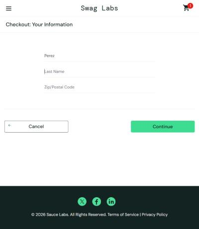
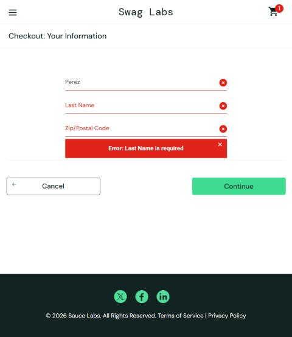
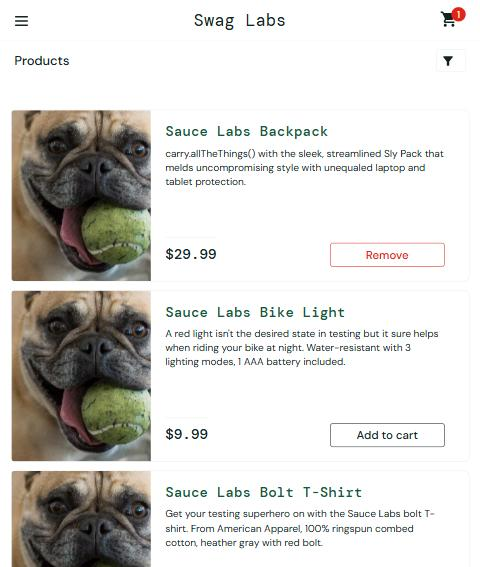

# Bugs encontrados — SauceDemo

## BUG-01 — Con `problem_user`, el campo "Last Name" sobrescribe "First Name" en el checkout
- **Caso relacionado:** CN-05
- **Severidad:** Alta (bloquea completar la compra) · **Prioridad:** Alta
- **Descripción:** En *Checkout: Your Information*, al escribir en *Last Name* el texto se coloca en *First Name* y *Last Name* permanece vacío, por lo que la validación impide continuar.
- **Precondiciones / datos:** Sesión con `problem_user` / `secret_sauce`; un producto en el carrito. First Name `Marcos`, Last Name `Perez`.
- **Pasos para reproducir:**
  1. Login con `problem_user`.
  2. Agregar *Sauce Labs Backpack* al carrito, abrir carrito y presionar **Checkout**.
  3. Escribir `Marcos` en *First Name*.
  4. Escribir `Perez` en *Last Name*.
  5. Presionar **Continue**.
- **Resultado esperado:** First Name = "Marcos", Last Name = "Perez"; avanzar o solicitar solo el Zip.
- **Resultado actual:** First Name = "Perez", Last Name vacío; mensaje *"Error: Last Name is required"*. Reproducible en cada intento.
- **Evidencia:**  
    
  

## BUG-02 — Con `problem_user`, todos los productos muestran la misma imagen incorrecta
- **Caso relacionado:** observado en la precondición de CN-05 (catálogo)
- **Severidad:** Media · **Prioridad:** Media
- **Descripción:** En `/inventory.html` los 6 productos muestran la misma imagen (un perro), que no corresponde a ningún producto. El recurso cargado es `/assets/sl-404-…jpg` para todos.
- **Precondiciones / datos:** Sesión con `problem_user` / `secret_sauce`.
- **Pasos para reproducir:**
  1. Login con `problem_user`.
  2. Observar el catálogo de productos.
- **Resultado esperado:** Cada producto muestra su propia imagen (mochila, luz de bicicleta, polera, etc.).
- **Resultado actual:** Las 6 tarjetas muestran la misma imagen genérica `sl-404`.
- **Evidencia:**  
  
