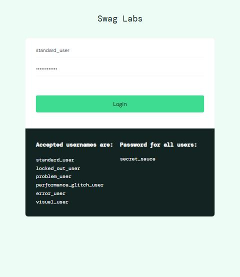
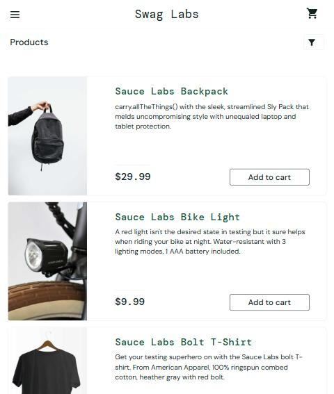
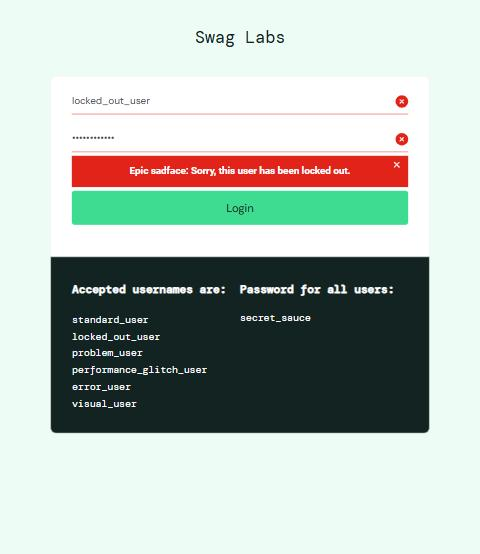
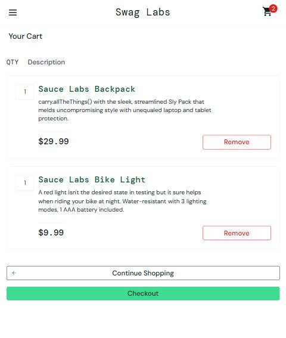
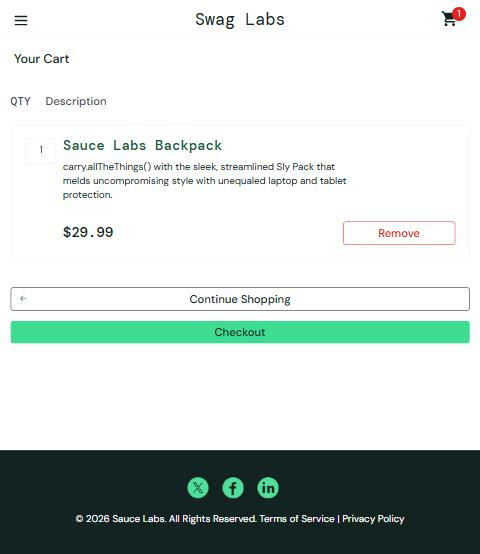
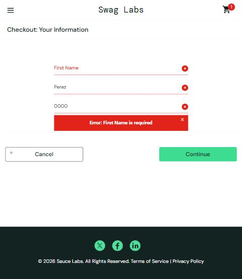
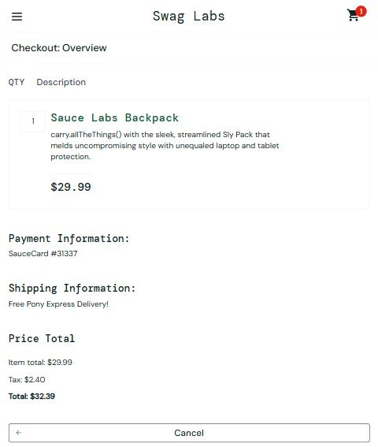
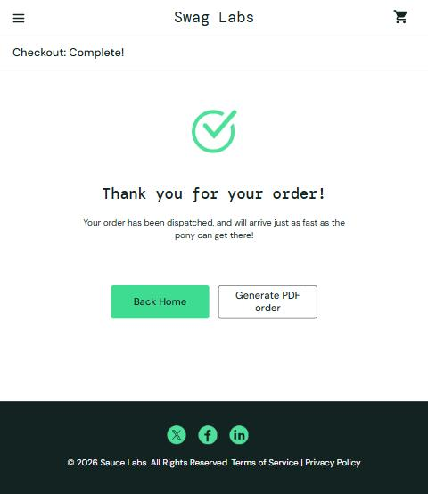

> **Repositorio:** https://github.com/AlexPanozo27/Examen-Hito-3-TQA

# Casos de prueba de Caja Negra — SauceDemo (Swag Labs)

**URL probada:** https://www.saucedemo.com/  
**Fecha de ejecución:** 20-10-2026  
**Navegador:** Chromium (escritorio)  
**Contraseña común de los usuarios demo:** `secret_sauce`

| ID | Título | Funcionalidad | Estado |
|----|--------|---------------|--------|
| CN-01 | Inicio de sesión con credenciales válidas | Login | ✅ Passed |
| CN-02 | Inicio de sesión con usuario bloqueado | Login | ✅ Passed |
| CN-03 | Agregar y eliminar productos del carrito | Carrito | ✅ Passed |
| CN-04 | Checkout completo con validación de campo obligatorio | Checkout | ✅ Passed |
| CN-05 | Checkout con `problem_user` — ingreso de datos del comprador | Checkout | ❌ Failed (BUG-01) |

---

## CN-01 — Inicio de sesión con credenciales válidas
- **Objetivo:** Verificar que un usuario válido accede al catálogo de productos.
- **Precondiciones:** Estar en la página de login, sin sesión iniciada.
- **Datos de prueba:** Usuario `standard_user` / Contraseña `secret_sauce`.
- **Pasos:**
  1. Abrir https://www.saucedemo.com/
  2. Ingresar `standard_user` en *Username*.
  3. Ingresar `secret_sauce` en *Password*.
  4. Presionar **Login**.
- **Resultado esperado:** Redirección a `/inventory.html`, título "Products" y listado de productos.
- **Resultado obtenido:** Se redirigió a `/inventory.html`, se mostró el título "Products" con 6 productos.
- **Estado:** ✅ Passed
- **Evidencia:**  
    
  

## CN-02 — Inicio de sesión con usuario bloqueado
- **Objetivo:** Verificar que un usuario bloqueado no puede ingresar y recibe un mensaje claro.
- **Precondiciones:** Estar en la página de login, sin sesión iniciada.
- **Datos de prueba:** Usuario `locked_out_user` / Contraseña `secret_sauce`.
- **Pasos:**
  1. Abrir https://www.saucedemo.com/
  2. Ingresar `locked_out_user` y `secret_sauce`.
  3. Presionar **Login**.
- **Resultado esperado:** El sistema permanece en el login y muestra un mensaje de error indicando que el usuario está bloqueado.
- **Resultado obtenido:** Permaneció en `/` y mostró: *"Epic sadface: Sorry, this user has been locked out."*
- **Estado:** ✅ Passed
- **Evidencia:**  
  

## CN-03 — Agregar y eliminar productos del carrito
- **Objetivo:** Verificar que el carrito refleja correctamente productos agregados y eliminados.
- **Precondiciones:** Sesión iniciada con `standard_user`, carrito vacío.
- **Datos de prueba:** Productos *Sauce Labs Backpack* ($29.99) y *Sauce Labs Bike Light* ($9.99).
- **Pasos:**
  1. En el catálogo, presionar **Add to cart** en *Sauce Labs Backpack*.
  2. Presionar **Add to cart** en *Sauce Labs Bike Light*.
  3. Verificar el contador del ícono del carrito.
  4. Abrir el carrito.
  5. Presionar **Remove** en *Sauce Labs Bike Light*.
- **Resultado esperado:** El contador muestra 2; el carrito lista ambos productos con su precio; tras eliminar, queda solo *Backpack* y el contador baja a 1.
- **Resultado obtenido:** Contador = 2; carrito con *Backpack $29.99* y *Bike Light $9.99*; tras **Remove**, solo *Backpack* y contador = 1.
- **Estado:** ✅ Passed
- **Evidencia:**  
    
  

## CN-04 — Checkout completo con validación de campo obligatorio
- **Objetivo:** Verificar que el checkout valida el nombre obligatorio y que una compra válida se completa con totales correctos.
- **Precondiciones:** Sesión con `standard_user`, *Sauce Labs Backpack* en el carrito.
- **Datos de prueba:** First Name: *(vacío)* y luego `Marcos`; Last Name: `Perez`; Zip: `0000`.
- **Pasos:**
  1. Abrir el carrito y presionar **Checkout**.
  2. Dejar *First Name* vacío, llenar *Last Name* y *Zip* y presionar **Continue**.
  3. Llenar *First Name* con `Marcos` y presionar **Continue**.
  4. Verificar el resumen (Item total, Tax, Total).
  5. Presionar **Finish**.
- **Resultado esperado:** Paso 2: mensaje "Error: First Name is required". Paso 4: Item total $29.99, impuesto y total coherentes. Paso 5: mensaje de confirmación de orden.
- **Resultado obtenido:** Paso 2: *"Error: First Name is required"*. Paso 4: Item total $29.99, Tax $2.40, Total $32.39 (29.99 + 2.40 = 32.39 ✔). Paso 5: *"Thank you for your order!"* en `/checkout-complete.html`.
- **Estado:** ✅ Passed
- **Evidencia:**  
    
    
  

## CN-05 — Checkout con `problem_user`: ingreso de datos del comprador
- **Objetivo:** Verificar que el formulario de checkout conserva los datos ingresados en cada campo.
- **Precondiciones:** Sesión con `problem_user`, *Sauce Labs Backpack* en el carrito.
- **Datos de prueba:** First Name `Marcos`, Last Name `Perez`.
- **Pasos:**
  1. Abrir el carrito y presionar **Checkout**.
  2. Hacer clic en *First Name* y escribir `Marcos`.
  3. Hacer clic en *Last Name* y escribir `Perez`.
  4. Presionar **Continue**.
- **Resultado esperado:** First Name = "Marcos", Last Name = "Perez"; al continuar solo debería pedir el Zip.
- **Resultado obtenido:** El texto escrito en *Last Name* aparece en *First Name* ("Perez") y *Last Name* queda vacío. Al continuar: *"Error: Last Name is required"*. No es posible completar la compra.
- **Estado:** ❌ Failed → ver **BUG-01**
- **Evidencia:**  
    
  
